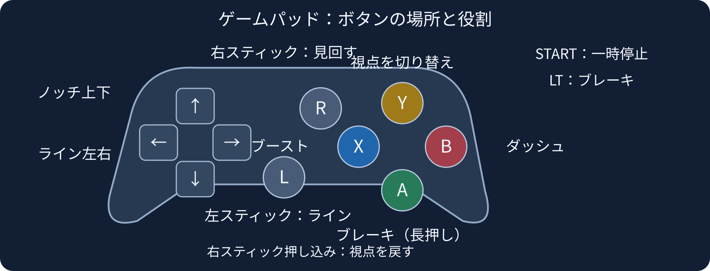
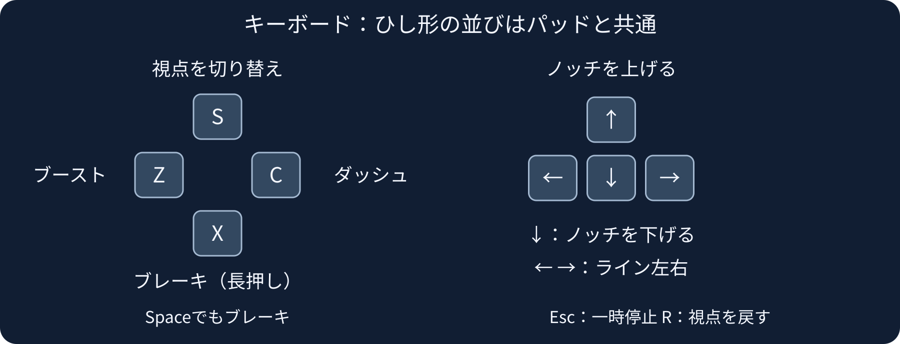
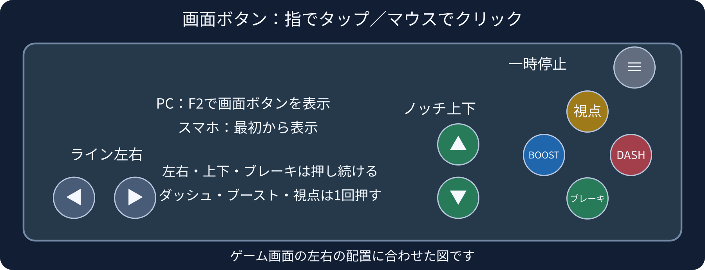

# ぷるりんレーサーズ　レース操作ガイド

あなたはトレーナーとして、ぷるりんに走る位置と走る力を指示します。
オフラインフリー対戦・ウェブ版オフラインテスト・オンラインフリー対戦で操作は共通です。

## 最初に覚えること

**左右でライン、上下でノッチ。** ノッチは0〜6の「走る力」の段階です。指定した速度に固定する操作ではありません。上げると力強く走り、下げると力を抑えます。

まず走りながら上下でノッチを変え、速度とハート（心拍）の変化を見てください。心拍200を超える走りが続くと走る力が落ちていきます。残スタミナにも気を配り、必要なところでダッシュやブーストを使います。

左右・ブレーキは**押している間**だけ働きます。ノッチ上下は1回で1段、押し続けると連続で変わります。ダッシュ・ブースト・視点切替は**1回押す**操作です。

## ゲームパッド

- 左スティック／十字キー左右：ライン左右
- 十字キー上下：ノッチを上げる・下げる
- A または左トリガー（LT）：ブレーキ。押している間だけ減速
- B：ダッシュ
- X：ブースト
- Y：視点切替
- 右スティック：倒した方向を見回す。離すと選んだ視点に戻る
- 右スティック押し込み：標準視点に戻す
- START：一時停止メニュー

図のA・B・X・Yはゲームが使う呼び名です。ボタンの文字が違うパッドは、タイトルの「ゲームパッド設定・入力確認」で反応する場所を確認してください。

## キーボード

- ← →：ライン左右
- ↑ ↓：ノッチを上げる・下げる
- X または Space：ブレーキ。押している間だけ減速
- C：ダッシュ
- Z：ブースト
- S：視点切替
- R：標準視点に戻す
- Esc：一時停止メニュー
- F2：画面ボタンの表示・非表示
- F3：詳細表示の切替

S・Z・X・Cは、ゲームパッドのY・X・A・Bと同じひし形の並びです。

## マウス・タッチ画面

スマホでは画面ボタンが最初から出ます。PCでマウスを使うときは、F2で表示してください。指で押す代わりに左クリックで操作できます。

- 左下の◀ ▶：ライン左右。押したまま左右へ滑らせても切り替わる
- 右側の▲ ▼：ノッチ上下
- 右下の「ブレーキ」：押している間だけ減速
- DASH：ダッシュ。1回押す
- BOOST：ブースト。1回押す
- 「視点」：視点切替。1回押す
- 右上の≡：一時停止メニュー

画面ボタンには「ブレーキ」「DASH」「BOOST」「視点」と表示されます。マウスだけでカメラを直接見回す操作はありません。

## 操作盤・順位表の見方

- 左上：自分の順位、残り距離、タイム。その下に順位表
- ハート：現在の心拍数
- 速さ・ノッチ：現在速度と指示中の段階
- 体力：残スタミナ。0を下回ると能力の効きが弱くなる
- 空気抵抗の軽減：前のぷるりんから受けるドラフトの効果
- ダッシュ・ブースト：使える状態を確認するゲージ

## メニューと操作ガイド

ゲーム内の「操作ガイド」は、モード選択とレース中の一時停止メニューから開けます。上のタブを押して、使う機器を選んでください。キーボード／パッドの左右でタブ、上下でスクロールできます。マウスホイールや指のスクロールも使えます。

メニューでは、十字キー／左スティック／矢印キーで移動し、A／Xキー／Enterで決定、B／Cキー／Escで戻ります。マウス・タッチでもボタンを選べます。

**オンラインでは、メニューや操作ガイドを開いている間もレースが進みます。** レース前に操作を確認してください。
